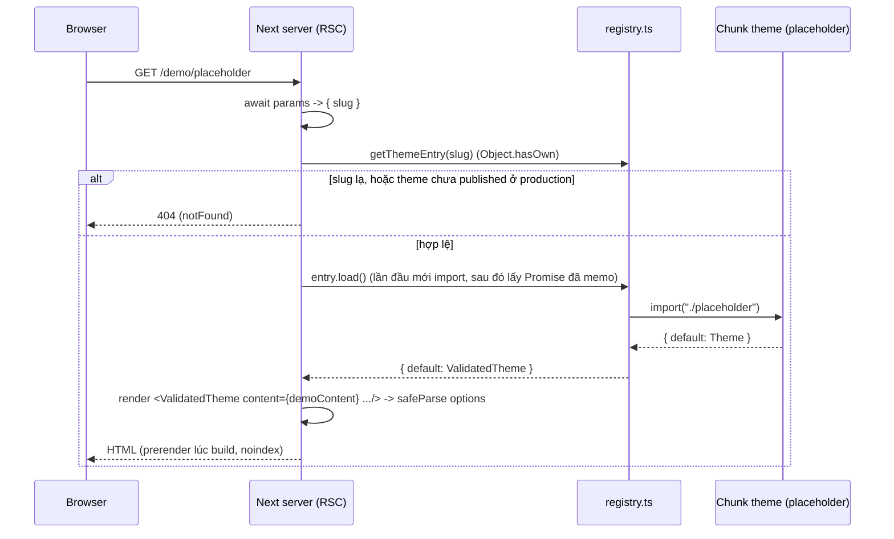
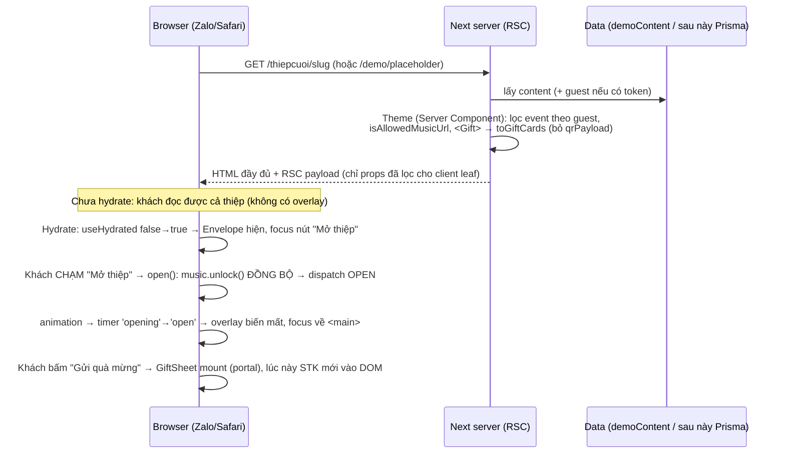

# M1 — Themes

> Bài này viết dần theo task. **Phần 1 (T-010): khung theme engine.** **Phần 2 (T-013): primitive trải
> nghiệm khách** (nằm cuối file). Các phần sau (CSS scoping, next/font, motion, âm lịch) thêm khi làm tới.

---

## Phần 1 — Khung theme engine (T-010)

Code cần mở song song khi đọc:

- `src/themes/types.ts`: hợp đồng dữ liệu
- `src/themes/registry.ts`: registry, `defineTheme`, `getThemeEntry`
- `src/themes/placeholder/manifest.ts` + `index.tsx`: theme khung đầu tiên
- `src/app/(thiep)/demo/[slug]/page.tsx`: route demo
- `src/themes/registry.test.ts`: test của registry
- `docs/07-THEMES.md` §2: bản spec của hợp đồng

### 1. Sơ đồ luồng



Lưu ý: chưa có DB trong luồng này. Route demo dùng `demoContent` cố định (`src/themes/_demo/content.ts`).
Lúc làm `/thiepcuoi/[slug]` thì bước "lấy dữ liệu" sẽ là Prisma → map ra `WeddingContent` → đưa vào đúng
cái theme này. Theme không đổi gì.

### 2. Bảy khái niệm

#### 2.1. Hợp đồng `ThemeProps`: dữ liệu tách khỏi theme

**Là gì.** Mọi theme chỉ nhận đúng một kiểu props:

```ts
// src/themes/types.ts:112-117
export interface ThemeProps<TOptions = unknown> {
  content: WeddingContent;
  guest?: GuestContext; // undefined on /thiepcuoi/[slug] and demo
  options: TOptions;
  mode: "live" | "preview" | "demo";
}
```

Theme không import Prisma, không đọc cookie, không biết user là ai. Nó là một hàm thuần: dữ liệu vào → giao
diện ra (`docs/07-THEMES.md` §1.1).

**Vì sao.** (1) Đổi theme = đổi `themeSlug` trong DB, dữ liệu giữ nguyên. (2) Một theme chạy được ở 3 chỗ
(thiệp thật, builder preview, demo) chỉ bằng cách đổi `mode` và nguồn dữ liệu. (3) Test dễ: render với
`demoContent` là xong, không cần mock DB. (4) Bảo mật dồn về một chỗ: kiểm quyền, lọc field nằm ở tầng lấy
dữ liệu, không rải trong 20 theme do Codex sản xuất.

**Sai thì hỏng gì.** Nếu theme tự query DB: 20 theme = 20 chỗ có thể quên kiểm quyền (IDOR), mỗi theme một
kiểu query, đổi schema DB là sửa 20 file. Và `WeddingContent` là "view model" (`dateLabel`, `lunarLabel`
đã tính sẵn), nên theme không phải tự format ngày hay tính âm lịch.

#### 2.2. Registry + dynamic `import()` → mỗi theme một chunk

**Là gì.**

```ts
// src/themes/registry.ts:42-44
export const themeRegistry = Object.freeze({
  placeholder: defineTheme(placeholderManifest, () => import("./placeholder")),
});
```

Chú ý: `manifest` import **tĩnh** (dòng 2), còn component theme import **động** (trong arrow function).
Manifest nhỏ, cần ngay để liệt kê gallery/sitemap. Component nặng (ảnh, motion, font) thì chỉ tải khi cần.
Bundler thấy `import("./placeholder")` sẽ tách thành một chunk riêng.

**Server Component await trên server.** `page.tsx:29`: `const { default: Theme } = await entry.load();`.
Page là `async` Server Component nên được `await` thẳng, không cần `React.lazy` hay `next/dynamic`. Việc
import xảy ra trên server; browser chỉ nhận HTML + JS của phần nào trong theme là `"use client"`.

**Sai thì hỏng gì.** Nếu import tĩnh hết: `import HongPastel from "./hong-pastel"` × 20 theme thì mọi thiệp
kéo code của cả 20 theme vào cùng bundle. Phần client của theme (nhạc, RSVP form) sẽ phình ra, LCP trên
điện thoại 4G tệ đi.

#### 2.3. `defineTheme`: gỡ generic `TOptions` mà không cần cast

**Vấn đề.** Mỗi theme có options riêng (`{ palette: "rose" | "sage" }`...). Registry phải chứa tất cả trong
một `Record<string, ThemeEntry>`, tức kiểu chung `ThemeModule<unknown>`. Mày sẽ nghĩ: `unknown` nhận được
mọi thứ, vậy gán `ComponentType<ThemeProps<PlaceholderOptions>>` vào `ComponentType<ThemeProps<unknown>>`
là xong. **TypeScript báo lỗi.**

**Vì sao (bản đơn giản).** Một component là một hàm nhận props. Kiểu `ComponentType<ThemeProps<unknown>>`
hứa với người gọi: "đưa tao `options` kiểu gì cũng được". Nhưng theme thật chỉ chịu được `options` đúng
kiểu `PlaceholderOptions`. Nếu cho gán, người gọi sẽ hợp lệ khi truyền `options: "sai-kieu"`, và theme
crash. Quy tắc: **với tham số hàm, chiều gán bị đảo ngược.** Hàm nhận `unknown` gán được vào chỗ cần hàm
nhận `X`, còn chiều ngược lại thì không. (Thuật ngữ: tham số là *contravariant*, bật bởi
`strictFunctionTypes` trong `strict`.)

Ví dụ đời thường: chỗ cần "thợ sửa được mọi loại xe" thì không thể nhét "thợ chỉ sửa Honda" vào.

**Cách mình gỡ.** Không cast `as`, mà bọc lại bằng một component thật sự nhận `unknown`:

```ts
// src/themes/registry.ts:24-30
function ValidatedTheme(props: ThemeProps<unknown>) {
  const parsed = manifest.optionsSchema.safeParse(props.options);
  return createElement(Theme, {
    ...props,
    options: parsed.success ? parsed.data : manifest.defaultOptions,
  });
}
```

Bên trong `defineTheme<TOptions>`, TS vẫn biết `manifest` và `Theme` cùng `TOptions` (cả hai tham số dùng
chung generic, dòng 16-19). `parsed.data` có kiểu `TOptions`, nên truyền vào `Theme` là đúng kiểu thật.
Lời hứa "nhận gì cũng được" giờ là thật vì có `safeParse` canh cửa.

**Sai thì hỏng gì.** Nếu viết `load as () => Promise<ThemeModule<unknown>>`: compile qua, nhưng `options`
hỏng từ DB đi thẳng vào theme và crash lúc runtime. Cast là mày tắt cảnh báo chứ không sửa được lỗi.

#### 2.4. Memo Promise bằng `??=`, và vì sao React cần cùng tham chiếu component

```ts
// src/themes/registry.ts:20, 37
let cached: Promise<ThemeModule<unknown>> | undefined;
// ...
load: () => (cached ??= loadValidated()),
```

`a ??= b` nghĩa là `a ?? (a = b)`: chỉ gán khi `a` là `null/undefined`, rồi trả về `a`.

**Memo Promise chứ không memo kết quả.** Hai request tới cùng lúc khi chưa import xong vẫn nhận **cùng một
Promise**, nên chỉ có một lần import và một lần tạo `ValidatedTheme`. Nếu memo kết quả (gán sau `await`) thì
trong lúc chờ, request thứ hai sẽ tự import lại.

**Vì sao cần cùng tham chiếu.** React so sánh element theo `type`. Nếu mỗi lần `load()` tạo ra một hàm
`ValidatedTheme` mới thì với React đó là **component khác**. Lần render sau React sẽ unmount cây cũ, mount
cây mới, và toàn bộ state con mất: form RSVP đang gõ dở bị xoá, nhạc đang phát bị dừng, animation chạy lại.
Chuyện này sẽ xảy ra thật ở builder preview khi Tony sửa nội dung và preview re-render.

Test khoá chuyện này: `registry.test.ts:36-41` kiểm `(await load()).default` hai lần phải `toBe` nhau.

#### 2.5. `safeParse` và `parse` ở biên dữ liệu

- `parse` ném exception khi sai. Dùng ở chỗ sai = phải dừng hẳn, và có người bắt lỗi: Server Action nhận
  form (bắt lỗi rồi trả message cho user), đọc env lúc khởi động.
- `safeParse` trả `{ success, data | error }`, không ném. Dùng ở chỗ sai = vẫn phải chạy tiếp được.

`options` của theme nằm trong DB dạng JSON. Theme lên version 2 đổi schema, row cũ còn options kiểu cũ. Nếu
dùng `parse` trong `ValidatedTheme` thì **khách mời mở thiệp thấy trang lỗi 500** chỉ vì một field màu. Với
`safeParse` + fallback `defaultOptions` thì thiệp vẫn hiện, chỉ mất tuỳ chỉnh. Test: `registry.test.ts:43-53`
truyền `options: "sai-kieu"` và vẫn phải render ra "Minh Anh".

Nguyên tắc: **ghi vào (input user) thì chặt, dùng `parse`/trả lỗi. Đọc ra (hiển thị cho khách) thì mềm,
dùng `safeParse` + fallback.**

#### 2.6. Next 16: `params` là Promise, `PageProps`, `generateStaticParams` + `notFound()`

```ts
// src/app/(thiep)/demo/[slug]/page.tsx:8-10, 19-27
export function generateStaticParams() {
  return themeSlugs.map((slug) => ({ slug }));
}
export default async function Page({ params }: PageProps<"/demo/[slug]">) {
  const { slug } = await params;
  // ...
  if (process.env.NODE_ENV === "production" && manifest.status !== "published") notFound();
```

- **`params` là Promise.** Từ Next 15 (bắt buộc ở 16), phải `await params`. Lý do: Next có thể bắt đầu render
  phần tĩnh của trang trước khi biết params. Quên `await` thì `slug` là `undefined` và mọi slug đều 404.
- **`PageProps<"/demo/[slug]">`** là type global do Next typegen sinh ra (khi `next dev`/`next build`/
  `next typegen`) từ cây thư mục `app/`. Mày truyền đúng route literal thì `params` tự có kiểu
  `Promise<{ slug: string }>`. Đổi tên thư mục `[slug]` mà quên sửa thì typecheck báo, không phải đợi runtime.
- **`generateStaticParams`** trả danh sách slug để Next **prerender lúc build**. Bật `cacheComponents` thì
  Next yêu cầu hàm này trả ít nhất một param, nên mình liệt kê **mọi** slug, kể cả theme draft.
- **`notFound()` lúc prerender.** Ở production build, với theme `draft` thì `notFound()` chạy ngay lúc build,
  nên Next ghi ra một trang **404 tĩnh** cho slug đó. Đây là cách chặn theme draft trên production: build
  vẫn qua, người ngoài gõ `/demo/placeholder` chỉ thấy 404. Ở `next dev` thì `NODE_ENV` khác `production` nên
  Tony vẫn xem được để QA.
- `generateMetadata` (dòng 12-17) gắn `robots: noindex, nofollow` cho cả trường hợp slug lạ: trang demo không
  bao giờ được Google index (tránh nội dung mỏng/trùng).

#### 2.7. `Object.hasOwn` chặn `__proto__` / `toString`

```ts
// src/themes/registry.ts:48-50
export function getThemeEntry(slug: string): ThemeEntry | undefined {
  return Object.hasOwn(themeRegistry, slug) ? themeRegistry[slug] : undefined;
}
```

`slug` đến từ URL, tức là user gõ gì cũng được. Nếu viết `themeRegistry[slug]` trần:

- `/demo/toString` → `themeRegistry["toString"]` là `Object.prototype.toString`, một hàm, **truthy**. Lệnh
  `if (!entry)` cho qua, rồi `entry.manifest` là `undefined`, `entry.manifest.status` ném TypeError → 500.
- `/demo/__proto__` → trả về `Object.prototype`, cùng kiểu lỗi.

`Object.hasOwn` chỉ trả `true` với key **chính chủ** của object, không lấy key thừa kế từ prototype. Test
khoá chuyện này: `registry.test.ts:55-59`. `Object.freeze` (dòng 42, 46) thêm một lớp: không code nào chạy
lúc runtime nhét thêm theme vào registry được.

### 3. Production khác bài học

- **Cache trong RAM theo từng process.** `cached` sống trong module scope. Trên AZDIGI, Passenger có thể chạy
  nhiều process Node, mỗi process import riêng một lần. Restart app (deploy) thì cache mất. Không sao vì chỉ
  là cache import, nhưng **đừng bao giờ** nhét dữ liệu theo user vào biến module scope kiểu này, vì nó được
  dùng chung giữa mọi request.
- **Không memo Promise bị reject.** Nếu `import()` lỗi một lần (chunk hỏng, đĩa đầy) mà `cached` vẫn giữ
  Promise reject thì process đó lỗi mãi tới khi restart. Vì vậy `registry.ts` reset `cached = undefined` trong
  `.catch` rồi ném lỗi tiếp — lần gọi sau sẽ thử import lại.
- **`NODE_ENV` được chốt lúc build.** Check `status !== "published"` (page.tsx:27) cho ra 404 tĩnh trong
  `.next`. Muốn publish theme thì sửa manifest rồi **build + deploy lại**, không có công tắc nào bật lúc
  runtime.
- **Prerender ăn RAM lúc build.** 20 theme × N trang demo đều render lúc `next build`. Host AZDIGI giới hạn RAM,
  nên build chạy ở CI (GitHub Actions) rồi mới đẩy bản standalone lên, không build trên host.
- **Chunk theo theme chỉ có lợi phía client** khi theme có phần `"use client"`. Theme placeholder không có
  client JS nào, nên chunk riêng lúc này chủ yếu giúp server không phải load hết 20 theme vào RAM.

### 4. Bảo mật

| Lỗ hổng có thể xảy ra | Code mình chặn ở đâu |
|---|---|
| Slug từ URL trỏ vào prototype (`__proto__`, `toString`) → 500, lộ stack | `Object.hasOwn` ở `registry.ts:49`, test `registry.test.ts:55-59` |
| `options` JSON hỏng/độc trong DB làm crash trang hoặc đẩy giá trị lạ vào theme | `safeParse` + `defaultOptions` ở `registry.ts:25-28` |
| Theme draft (chưa QA, có thể lộ asset chưa có license) xuất hiện ở production | `notFound()` ở `page.tsx:27` → 404 tĩnh |
| Trang demo bị Google index | `robots: noindex, nofollow` ở `page.tsx:15-16` |
| Lộ `qrPayload` (chuỗi VietQR chứa số tài khoản) ra text trong HTML | Theme chỉ render số tài khoản; test `registry.test.ts:51` kiểm HTML không chứa `000201` |
| XSS qua lời mời/tên do user nhập | Luật trong `types.ts:75-76`: cấm `dangerouslySetInnerHTML` trong `src/themes/**`, chỉ render text (React tự escape) |
| Lộ `guest.token` qua RSC payload khi đưa cả object `guest` vào Client Component | Ghi chú luật ở `types.ts:106-108`: chỉ đưa field cần thiết xuống client |
| URL ảnh/map/nhạc do user nhập trỏ ra host lạ (`javascript:`, tracking) | Hiện mới là ghi chú ở `types.ts:15, 40-43, 91`: **chưa có code chặn**, phải làm ở Zod input khi làm builder |

Dòng cuối là việc còn nợ, nhớ nó khi tới M3.

### 5. Câu hỏi tự kiểm tra

1. Vì sao theme không được tự query Prisma, kể cả khi làm vậy viết code nhanh hơn? Nêu ít nhất 2 hậu quả
   cụ thể với dự án 20 theme.

   > Trả lời:

2. Có `const Fn: (p: { options: unknown }) => void`. Gán một hàm kiểu `(p: { options: { a: number } }) => void`
   vào `Fn` thì TS báo lỗi. Giải thích bằng lời của mày, rồi cho biết `defineTheme` né lỗi này thế nào mà
   không dùng `as`.

   > Trả lời:

3. Nếu sửa dòng 37 `registry.ts` thành `load: () => loadValidated()` thì test nào fail? Trong builder preview,
   khách sẽ thấy lỗi gì?

   > Trả lời:

4. Trong `ValidatedTheme` tao dùng `safeParse`, còn ở Server Action lưu options tao sẽ dùng kiểm chặt và trả
   lỗi. Vì sao hai chỗ cùng một schema mà xử lý ngược nhau?

   > Trả lời:

5. Theme `placeholder` đang `status: "draft"`. Mô tả chuyện xảy ra từ lúc `next build` tới lúc có người gõ
   `/demo/placeholder` trên production. Nếu bỏ hẳn `generateStaticParams` thì sao (gợi ý: `cacheComponents`)?

   > Trả lời:

---

## Phần 2 — Primitive trải nghiệm khách (T-013)

Code cần mở song song:

- `src/themes/_shared/`: `use-envelope.ts`, `Envelope.tsx`, `use-music.ts`, `use-client-env.ts`,
  `use-countdown.ts`, `Gift.tsx`, `gift-cards.ts`, `GiftSheet.tsx`, `calendar.ts`, `scroll-lock.ts`, `Reveal.tsx`
- `src/themes/placeholder/index.tsx` + `Experience.tsx`
- `src/lib/url-allowlist.ts`, `src/lib/qr.ts`
- `docs/07-THEMES.md` §3 (bảng primitive), §10 (hành trình khách)

### 1. Sơ đồ luồng



Chưa có DB thật: bước "lấy content" vẫn là `demoContent`. Điểm quan trọng của sơ đồ: **mọi quyết định bảo mật
(lọc event, lọc QR, check URL) xảy ra ở bước Server trước khi serialize**; browser chỉ nhận cái đã lọc.

### 2. Tám khái niệm

#### 2.1. User activation và autoplay: `onOpen()` phải chạy đồng bộ đầu handler

**Là gì.** Trình duyệt chỉ cho `audio.play()` có tiếng khi trang đang có *user activation*: một cú chạm/click
thật vừa xảy ra và "còn hạn" (Safari/webview Zalo khắt khe nhất: phải gọi `play()` ngay trong call stack của
event handler). Qua `await`, `setTimeout` hay sau animation là hết hạn, `play()` bị từ chối.

```ts
// src/themes/_shared/use-envelope.ts:38-43
const open = useCallback(() => {
  // FIRST and synchronous: audio.play() is only allowed while the tap is still the "active user gesture"...
  onOpen?.();
  dispatch({ type: "OPEN" });
}, [onOpen]);
```

`onOpen` chính là `music.unlock` do `Experience.tsx:27` truyền xuống `<Envelope onOpen={music.unlock}>`. Thứ tự
trong `open()` không phải sở thích: gọi `unlock()` **trước** `dispatch`. `dispatch` chỉ xếp hàng update, nhưng
nếu mày chèn `await` hay `setTimeout(unlock, 600)` ("đợi animation xong rồi phát cho mượt") thì nhạc câm trên
iPhone.

**Sai thì hỏng gì.** Trên Chrome desktop test vẫn nghe nhạc (autoplay policy dễ hơn, hoặc đã tương tác trước đó),
lên Zalo iOS thì im lặng, và `play()` reject âm thầm. Lỗi chỉ lộ trên máy thật: QA §8 bắt buộc test Zalo iOS.

#### 2.2. `useSyncExternalStore` với server snapshot khác client

**Vấn đề.** Cần giá trị chỉ có ở browser (đã hydrate chưa, giờ hiện tại, `prefers-reduced-motion`). Cách quen
tay: `useState(false)` + `useEffect(() => setX(true), [])`. Nó chạy, nhưng render thêm một lần và lint
`react-hooks/set-state-in-effect` kêu. Còn nếu đọc thẳng `Date.now()`/`window.matchMedia` trong render thì
HTML server khác HTML client → **hydration mismatch**.

**Cách mình làm.** `useSyncExternalStore(subscribe, getClientSnapshot, getServerSnapshot)`: React dùng
`getServerSnapshot` khi SSR **và cả lúc hydrate**, rồi mới đổi sang client snapshot và render lại.

```ts
// src/themes/_shared/use-client-env.ts:9-15
export function useHydrated(): boolean {
  return useSyncExternalStore(noopSubscribe, () => true, () => false);
}
// src/themes/_shared/use-countdown.ts:27-29, 36
const getNowSeconds = () => Math.floor(Date.now() / 1000);
const getServerNow = () => null;
const nowSeconds = useSyncExternalStore(subscribeClock, getNowSeconds, getServerNow);
```

Hai chi tiết đáng nhớ trong `use-countdown.ts`:

- Snapshot là **giây nguyên** (dòng 27), không phải `Date.now()` mili-giây. React so snapshot bằng `Object.is`;
  trả giá trị đổi mỗi lần gọi thì React thấy store "luôn đổi" và render vô hạn.
- `subscribeClock` (dòng 6-24) chỉ chạy `setInterval` khi tab visible, `visibilitychange` quay lại thì tick
  ngay. Tab nền trong Zalo không đốt timer.

**Sai thì hỏng gì.** Đọc `Date.now()` trong render: server render "12 ngày 03:00:05", client hydrate ra
"12 ngày 03:00:06" → cảnh báo mismatch, React bỏ HTML server và dựng lại. Hook trả `null` ở server nên theme phải
render chỗ giữ chỗ khi `null`.

#### 2.3. Ranh giới Server/Client là ranh giới serialize

Mọi props đi từ Server Component sang Client Component đều bị **serialize vào RSC payload**, tức nằm trong
HTML gửi cho khách (xem được bằng View Source). Hệ quả ba tầng:

**(a) Lọc ở server, trước ranh giới.** `Gift.tsx` là Server Component, map `GiftView → GiftCard` rồi mới đưa
cho client leaf:

```ts
// src/themes/_shared/gift-cards.ts:3-4, 35-42
// ...Deliberately drops `qrPayload` (never rendered) so it is not serialized into the RSC payload.
{ id, side, bankName, accountName, accountNumber, qrSvg: isQrDataUri(gift.qrSvg) ? gift.qrSvg : undefined }
// src/themes/_shared/Gift.tsx:19  const cards = toGiftCards(gifts);
```

Nếu mày đưa thẳng `gifts` vào `GiftButton` (`"use client"`), chuỗi VietQR (`qrPayload`, có STK) nằm trong
payload dù UI không vẽ nó. `"use client"` không phải hàng rào bảo mật; chỉ có *không đưa field xuống* mới là hàng rào.

**(b) Hàm không đi qua ranh giới.** `music.unlock` là hàm, Server Component không thể truyền hàm vào Client
Component. Nên mới có `Experience.tsx` (dòng 22-31): một client leaf chứa **cả** `useMusic`, `<Envelope>`,
`<MusicToggle>` để hook và các nút dùng chung một cây client. Phần bìa (tên + ngày) vẫn render ở server và vào
leaf qua `children` (`index.tsx:58-65`). Pattern: *client leaf nhỏ, nhận server content qua children*.

**(c) Token khách không xuống client.** `index.tsx:52-53` ghi rõ: truyền từng field (`maxAttendees`,
`rsvp`, `invitedEventIds`) vào `RsvpForm`, không truyền cả `guest` vì `guest.token` nằm trong đó.

**Sai thì hỏng gì.** Lộ STK/QR cho bot cào, lộ token khách = ai có token đều RSVP thay được. Chú ý
`docs/07-THEMES.md` §10: tự `gifts` nằm trong props server là chấp nhận được (STK cặp đôi chủ động đưa), nhưng
`qrPayload` thì không cần thiết nên cắt.

#### 2.4. Progressive enhancement: Envelope và Reveal chỉ ẩn nội dung sau hydrate

Nguyên tắc: HTML từ server phải **đọc được khi không có JS**. Phần "trang trí" (overlay phong bì, hiệu ứng
fade) chỉ được che nội dung *sau khi* JS chắc chắn chạy.

- `Envelope.tsx:69`: `if (!hydrated || envelope.isOpen) return null;` → server không render overlay. JS lỗi/tắt
  thì khách đọc thẳng thiệp. Đổi lại: màn hình chậm sẽ thấy nội dung nháy một lúc trước khi overlay hiện
  (trade-off ghi ở comment dòng 24-27).
- `Reveal.tsx:29`: HTML server luôn hiện đủ; chỉ trong `useEffect`, và chỉ với phần tử còn dưới màn hình
  (dòng 27), mới gán `el.dataset.reveal = "hidden"` thẳng lên DOM. Không dùng state → không render thừa, và
  không dùng IntersectionObserver / bật reduced-motion thì nội dung cứ hiện (dòng 25). Cleanup (dòng 42) trả
  về `"shown"` để không bỏ phần tử kẹt ở trạng thái ẩn.

**Sai thì hỏng gì.** Nếu `Reveal` render `opacity-0` từ server: JS fail → cả album vô hình vĩnh viễn, Google
cũng thấy trang rỗng-ish. Nếu overlay phong bì render từ server mà JS không chạy: khách bị chặn ngoài thiệp,
không có nút nào bấm được.

#### 2.5. Validate URL an toàn: `new URL()` tự "sửa" input

Đây là chỗ trả nợ dòng cuối bảng bảo mật Phần 1 (URL user nhập). `src/lib/url-allowlist.ts` chặn theo 3 nguyên tắc:

1. **Kiểm chuỗi gốc *trước* khi parse.** `new URL("https://goo\tgl.com")` âm thầm bỏ tab/newline, và coi `\`
   như `/`. Nếu chỉ kiểm `url.hostname` sau parse thì chuỗi bẩn vẫn "sạch". Vì vậy dòng 48 chạy
   `SAFE_CHARS` (ASCII in được, không khoảng trắng, không `\`) trên **chuỗi gốc**, và dòng 49 yêu cầu đúng
   `https://` ở đầu.
2. **So host chính xác, không `endsWith/includes`.** `(MAP_HOSTS as readonly string[]).includes(url.hostname)`
   (dòng 82): so với danh sách cố định. `endsWith("google.com")` sẽ cho qua `evilgoogle.com`. Parser đã hạ chữ
   thường hostname nên `GOOGLE.com` vẫn khớp, còn `user:pass@` (dòng 57) và port lạ (dòng 58) bị loại.
3. **Open redirect trên host đáng tin.** `maps.google.com/url?q=https://evil.com` là link *của Google* nhưng
   Google chuyển tiếp khách sang evil.com. Host trong allowlist chưa đủ, phải ép pathname:

```ts
// src/lib/url-allowlist.ts:83-85
if (url.hostname === "maps.app.goo.gl") return true;
if (url.pathname === "/maps" || url.pathname.startsWith("/maps/")) return true;
return url.pathname === "/" && MAP_HOSTS_ROOT_ALLOWED.includes(url.hostname);
```

Kết hợp `.transform((v) => new URL(v).href)` (dòng 109): sau khi *đã validate bằng chuỗi gốc*, mới lưu dạng đã
chuẩn hoá. Thứ tự "kiểm chuỗi gốc → parse → so sánh → lưu dạng chuẩn" là mấu chốt.

Dùng ở đâu: `index.tsx:41-42` (`isAllowedMusicUrl` → không hợp lệ thì không có `musicSrc`, ♪ biến mất),
`MapButton` cho `mapUrl`. `isInternalPath` (dòng 33-39) chặn `//host`, `..`, `%2e`.

**Sai thì hỏng gì.** `javascript:` / link phishing trong nút "Chỉ đường", khách bấm từ thiệp của mình → mất uy tín
cả nền tảng.

#### 2.6. SVG trong `` vs inline: vì sao `qrSvg` là data URI

`src/lib/qr.ts:20-21` sinh SVG bằng thư viện `qrcode` rồi trả `data:image/svg+xml;base64,...`. Comment dòng 9-11
nói lý do: SVG nạp qua `` **không bao giờ chạy script** (và không tải tài nguyên ngoài), còn SVG inline /
`dangerouslySetInnerHTML` thì `<script>`, `onload=` chạy với quyền của trang.

Phòng thủ thành hai lớp:

- Sinh: `qr.ts` có `import "server-only"` (dòng 1, import từ client là build fail) và giới hạn
  `MAX_QR_PAYLOAD_LENGTH` 512 (dòng 17).
- Dùng: `isQrDataUri` (`gift-cards.ts:25-27`) chỉ nhận đúng mẫu `data:image/svg+xml;base64,[A-Za-z0-9+/=]+`.
  Giá trị khác (url lạ, SVG thô) bị `toGiftCards` bỏ, sheet hiện chữ "Chưa có mã QR".

`GiftSheet.tsx:231-238` render bằng `<Image ... unoptimized>`: `unoptimized` vì data URI không đi qua optimizer
của Next, và vì vậy cũng không phình cache trên host.

**Sai thì hỏng gì.** Nếu cho SVG từ input user vào inline = XSS lưu vĩnh viễn trên thiệp thật, chạy trên máy mọi
khách. Đó là lý do comment cấm "accept it from input".

#### 2.7. Bài học: test xanh mà code sai (`"\;"` trong calendar.ts)

Escape TEXT của iCalendar (RFC 5545) cần chèn **dấu `\` thật** trước `;` và `,`. Trong string JS:

```ts
// src/themes/_shared/calendar.ts:30-33
.replace(/\\/g, "\\\\")   // \ → \\
.replace(/;/g, "\\;")     // ; → \;   (đúng)
// SAI kiểu hay gặp:  "\;"  — trong JS `"\;"` CHÍNH LÀ ";" (escape lạ bị bỏ dấu \)
```

`"\;"` không báo lỗi, không cảnh báo, nó chỉ là `";"`. Hàm "replace `;` bằng `;`" không làm gì cả. Nguy hiểm
nhất là test cũng viết `toBe("a\;b")` bằng chính cú pháp sai đó: **hai vế sai giống nhau nên test xanh**. File
`.ics` thật bị dính `LOCATION:Sảnh A; Tầng 2` → Apple/Google Calendar cắt địa chỉ tại dấu `;`.

Cách mình khoá: test viết kỳ vọng ở dạng **dữ liệu cuối** (output mà RFC yêu cầu), nhìn thấy `\\;` rõ ràng:
`calendar.test.ts:33` (`"a\\\\b\\;c\\,d\\ne\\nf"`) và `:66` (`"LOCATION:Sảnh A\\; Tầng 2\\, 12 Lê Lợi\\, Q1\r\n"`).
Quy tắc rút ra: *test cần ví dụ viết độc lập với cách code sinh ra; chỗ có escape thì in output ra mắt nhìn,
hoặc test round-trip bằng parser thật.* Test xanh chỉ chứng minh code khớp test, không chứng minh khớp thế giới thật.

#### 2.8. Bài tập của Tony: `useMusic` (🔴 tự code)

`src/themes/_shared/use-music.ts` hiện là hàm rỗng trả `SILENT`; Tony tự viết (AGENTS.md §7, agent không viết
hộ). Interface đã cố định (`MusicController`: `isPlaying`, `isMuted`, `unlock`, `toggle`). Checklist rút từ TODO
dòng 19-45:

1. `src` rỗng hoặc `opts.disabled` (preview) → trả controller câm, **không tạo `Audio`**.
2. Một `new Audio(src)` duy nhất, tạo lười trên client (`useRef`, không trong render/SSR), `preload="none"`,
   `loop = true`.
3. `unlock()`: nếu chưa mute thì gọi `audio.play()` **ngay**, trước mọi `await`/`setTimeout`. Bắt reject của
   Promise → `isPlaying=false`, không ném lỗi. Gọi 2 lần không phát lại từ đầu.
4. `toggle()`: đang phát → pause + nhớ muted; đang tắt → play (cú bấm này cũng là gesture) + xoá muted.
5. Nhớ muted trong `sessionStorage` (key `henuoc:music-muted`), bọc `try/catch` (Safari private mode ném lỗi).
   Muted thì `unlock()` không phát.
6. `visibilitychange`: hidden → pause (nhớ đang phát); visible → phát tiếp **chỉ khi** trước đó đang phát và chưa mute.
7. `isPlaying` đồng bộ qua event `play`/`pause`/`ended` của chính element, không tin cờ tự giữ.
8. Cleanup khi unmount / đổi `src`: gỡ listener, `pause()`, `audio.src = ""`.
9. Trả object ổn định (`useMemo`/`useCallback`) để `Envelope` (`onOpen`) và `MusicToggle` không render thừa. Đặc
   biệt: `useEnvelope.open` có `onOpen` trong deps (`use-envelope.ts:43`).

Gợi ý tự kiểm: ý 9 liên quan thẳng bài 2.1 (hàm `unlock` đổi tham chiếu mỗi render thì `open` cũng đổi). Kẹt thì
dán code + lỗi cho Claude, đừng xin viết hộ. QA bắt buộc: Zalo iOS nghe được ngay khi chạm; khoá màn hình rồi
mở lại; preview không phát.

### 3. Production khác bài học

- **Cache/CDN:** HTML thiệp có `guest` (token) phải **không** bị cache dùng chung; trang chung `/thiepcuoi/[slug]`
  thì cache được. Khi làm routing M3, đừng để bản có salutation của khách A lọt vào cache phục vụ khách B.
- **Webview Zalo/Facebook** khác Safari/Chrome: autoplay chặt, `navigator.clipboard` có thể thiếu (đó là lý do
  `GiftSheet.tsx:212-219` có fallback chọn chữ), `sessionStorage` có thể ném lỗi.
- **Nhạc nằm ngoài host AZDIGI:** MP3 ≤ 3MB trên R2 (`media.henuoc.com`, `MEDIA_HOSTS`), `preload="none"` để
  không tốn băng thông chưa chạm. Domain R2 chưa chốt, đổi ở một chỗ (`url-allowlist.ts:7`).
- **Allowlist là nguồn sự thật ở server.** Trong dev dùng `/audio/...` nội bộ, production dùng R2: hai nhánh
  đều qua `isAllowedMediaUrl`, đừng mở thêm host "tạm" rồi quên.
- **Cạm bẫy `sessionStorage`:** "đã tắt nhạc" chỉ nhớ trong phiên tab. Khách đóng mở lại là nhạc có thể phát
  lại khi chạm mở phong bì, đúng thiết kế (§10).
- **RAM host:** các primitive đều nhẹ (không thư viện animation), `qrSvgDataUri` sinh lúc lấy dữ liệu, không
  tạo mỗi request trên client.

### 4. Bảo mật

| Lỗ hổng có thể xảy ra | Code mình chặn ở đâu |
|---|---|
| Lộ `qrPayload` (chứa STK) và field thừa khác qua RSC payload | `toGiftCards` chỉ copy field cần (`gift-cards.ts:30-45`), `Gift.tsx:19` chạy ở server |
| Lộ `guest.token` vì đưa cả `guest` vào client | `index.tsx:52-53,171-182`: truyền từng field; `Experience` không nhận `guest` |
| `javascript:`/phishing/open redirect qua URL map, nhạc, ảnh | `url-allowlist.ts:26,48-60,83-85`; `index.tsx:41-42` bỏ nhạc không hợp lệ |
| XSS qua SVG (QR) | ``/`Image` không chạy script (`qr.ts:9-11`), `isQrDataUri` (`gift-cards.ts:25`), `server-only` (`qr.ts:1`) |
| Chèn dòng lạ vào file `.ics` (`\r\n` trong tên địa điểm → thêm thuộc tính) | `escapeText` đổi newline thành `\n` (`calendar.ts:33`); `icsFileName` lọc ký tự tên file (`:113`) |
| Tên file `.ics` chứa `../` | `calendar.ts:113` chỉ giữ `[a-zA-Z0-9-_]` |
| Overlay chặn khách khi JS lỗi (từ chối dịch vụ tự gây) | Overlay chỉ render sau hydrate (`Envelope.tsx:69`), timer fallback kẹt "opening" (`use-envelope.ts:49-53`) |
| STK bị cào bởi bot | **Chưa chặn hoàn toàn**: sheet chỉ mount STK khi mở (`GiftSheet.tsx:38`), nhưng `gifts` vẫn có trong payload (ghi chú `docs/07` §10). Muốn chặn: tải `gifts` khi bấm + rate limit, làm sau |

### 5. Câu hỏi tự kiểm tra

1. Vì sao `onOpen?.()` đứng trước `dispatch` và cấm bọc trong `setTimeout`/`await`? Kể một tình huống test trên
   Chrome desktop thấy ổn nhưng khách Zalo iOS thì không nghe nhạc.

   > Trả lời:

2. Server render countdown, client hydrate sau đó 3 giây. Vì sao `useSyncExternalStore(..., getServerNow = () => null)`
   không bị hydration mismatch, còn `Math.floor(Date.now()/1000)` đặt thẳng trong render thì bị? Vì sao snapshot
   phải là giây nguyên chứ không phải `Date.now()`?

   > Trả lời:

3. `GiftButton` là `"use client"`. Nếu `Gift.tsx` truyền thẳng `gifts` (có `qrPayload`) xuống, dù UI không vẽ
   `qrPayload` thì có vấn đề gì? Vì sao cần `Experience.tsx` làm client leaf riêng thay vì để `index.tsx` gọi
   `useMusic` trực tiếp?

   > Trả lời:

4. Cho `https://maps.google.com/url?q=https://evil.com`. Host nằm trong `MAP_HOSTS`, vậy `isAllowedMapUrl` chặn nó
   ở dòng nào và vì sao? Rồi giải thích vì sao phải chạy `SAFE_CHARS` trên chuỗi gốc **trước** `new URL()`.

   > Trả lời:

5. `"a\;b"` trong JS bằng gì? Vì sao một test viết `expect(escapeText("a;b")).toBe("a\;b")` sẽ xanh dù hàm
   escape sai, và mày làm gì để test không bị "xanh giả" kiểu này?

   > Trả lời:
