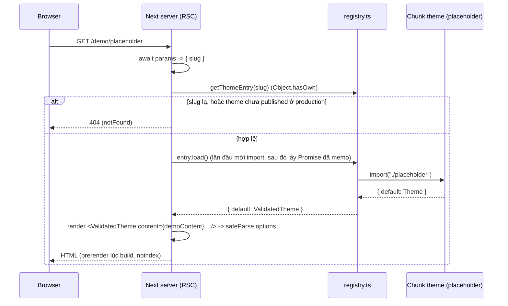

# M1 — Themes

> Bài này viết dần theo task. **Phần 1 (T-010): khung theme engine.** Các phần sau (hook dùng chung,
> CSS scoping, next/font, motion, âm lịch) thêm khi làm tới.

---

## Phần 1 — Khung theme engine (T-010)

Code cần mở song song khi đọc:

- `src/themes/types.ts`: hợp đồng dữ liệu
- `src/themes/registry.ts`: registry, `defineTheme`, `getThemeEntry`
- `src/themes/placeholder/manifest.ts` + `index.tsx`: theme khung đầu tiên
- `src/app/(thiep)/demo/[slug]/page.tsx`: route demo
- `src/themes/registry.test.ts`: test của registry
- `docs/07-THEMES.md` §2: bản spec của hợp đồng

### 1. Sơ đồ luồng



Lưu ý: chưa có DB trong luồng này. Route demo dùng `demoContent` cố định (`src/themes/_demo/content.ts`).
Lúc làm `/thiepcuoi/[slug]` thì bước "lấy dữ liệu" sẽ là Prisma → map ra `WeddingContent` → đưa vào đúng
cái theme này. Theme không đổi gì.

### 2. Bảy khái niệm

#### 2.1. Hợp đồng `ThemeProps`: dữ liệu tách khỏi theme

**Là gì.** Mọi theme chỉ nhận đúng một kiểu props:

```ts
// src/themes/types.ts:112-117
export interface ThemeProps<TOptions = unknown> {
  content: WeddingContent;
  guest?: GuestContext; // undefined on /thiepcuoi/[slug] and demo
  options: TOptions;
  mode: "live" | "preview" | "demo";
}
```

Theme không import Prisma, không đọc cookie, không biết user là ai. Nó là một hàm thuần: dữ liệu vào → giao
diện ra (`docs/07-THEMES.md` §1.1).

**Vì sao.** (1) Đổi theme = đổi `themeSlug` trong DB, dữ liệu giữ nguyên. (2) Một theme chạy được ở 3 chỗ
(thiệp thật, builder preview, demo) chỉ bằng cách đổi `mode` và nguồn dữ liệu. (3) Test dễ: render với
`demoContent` là xong, không cần mock DB. (4) Bảo mật dồn về một chỗ: kiểm quyền, lọc field nằm ở tầng lấy
dữ liệu, không rải trong 20 theme do Codex sản xuất.

**Sai thì hỏng gì.** Nếu theme tự query DB: 20 theme = 20 chỗ có thể quên kiểm quyền (IDOR), mỗi theme một
kiểu query, đổi schema DB là sửa 20 file. Và `WeddingContent` là "view model" (`dateLabel`, `lunarLabel`
đã tính sẵn), nên theme không phải tự format ngày hay tính âm lịch.

#### 2.2. Registry + dynamic `import()` → mỗi theme một chunk

**Là gì.**

```ts
// src/themes/registry.ts:42-44
export const themeRegistry = Object.freeze({
  placeholder: defineTheme(placeholderManifest, () => import("./placeholder")),
});
```

Chú ý: `manifest` import **tĩnh** (dòng 2), còn component theme import **động** (trong arrow function).
Manifest nhỏ, cần ngay để liệt kê gallery/sitemap. Component nặng (ảnh, motion, font) thì chỉ tải khi cần.
Bundler thấy `import("./placeholder")` sẽ tách thành một chunk riêng.

**Server Component await trên server.** `page.tsx:29`: `const { default: Theme } = await entry.load();`.
Page là `async` Server Component nên được `await` thẳng, không cần `React.lazy` hay `next/dynamic`. Việc
import xảy ra trên server; browser chỉ nhận HTML + JS của phần nào trong theme là `"use client"`.

**Sai thì hỏng gì.** Nếu import tĩnh hết: `import HongPastel from "./hong-pastel"` × 20 theme thì mọi thiệp
kéo code của cả 20 theme vào cùng bundle. Phần client của theme (nhạc, RSVP form) sẽ phình ra, LCP trên
điện thoại 4G tệ đi.

#### 2.3. `defineTheme`: gỡ generic `TOptions` mà không cần cast

**Vấn đề.** Mỗi theme có options riêng (`{ palette: "rose" | "sage" }`...). Registry phải chứa tất cả trong
một `Record<string, ThemeEntry>`, tức kiểu chung `ThemeModule<unknown>`. Mày sẽ nghĩ: `unknown` nhận được
mọi thứ, vậy gán `ComponentType<ThemeProps<PlaceholderOptions>>` vào `ComponentType<ThemeProps<unknown>>`
là xong. **TypeScript báo lỗi.**

**Vì sao (bản đơn giản).** Một component là một hàm nhận props. Kiểu `ComponentType<ThemeProps<unknown>>`
hứa với người gọi: "đưa tao `options` kiểu gì cũng được". Nhưng theme thật chỉ chịu được `options` đúng
kiểu `PlaceholderOptions`. Nếu cho gán, người gọi sẽ hợp lệ khi truyền `options: "sai-kieu"`, và theme
crash. Quy tắc: **với tham số hàm, chiều gán bị đảo ngược.** Hàm nhận `unknown` gán được vào chỗ cần hàm
nhận `X`, còn chiều ngược lại thì không. (Thuật ngữ: tham số là *contravariant*, bật bởi
`strictFunctionTypes` trong `strict`.)

Ví dụ đời thường: chỗ cần "thợ sửa được mọi loại xe" thì không thể nhét "thợ chỉ sửa Honda" vào.

**Cách mình gỡ.** Không cast `as`, mà bọc lại bằng một component thật sự nhận `unknown`:

```ts
// src/themes/registry.ts:24-30
function ValidatedTheme(props: ThemeProps<unknown>) {
  const parsed = manifest.optionsSchema.safeParse(props.options);
  return createElement(Theme, {
    ...props,
    options: parsed.success ? parsed.data : manifest.defaultOptions,
  });
}
```

Bên trong `defineTheme<TOptions>`, TS vẫn biết `manifest` và `Theme` cùng `TOptions` (cả hai tham số dùng
chung generic, dòng 16-19). `parsed.data` có kiểu `TOptions`, nên truyền vào `Theme` là đúng kiểu thật.
Lời hứa "nhận gì cũng được" giờ là thật vì có `safeParse` canh cửa.

**Sai thì hỏng gì.** Nếu viết `load as () => Promise<ThemeModule<unknown>>`: compile qua, nhưng `options`
hỏng từ DB đi thẳng vào theme và crash lúc runtime. Cast là mày tắt cảnh báo chứ không sửa được lỗi.

#### 2.4. Memo Promise bằng `??=`, và vì sao React cần cùng tham chiếu component

```ts
// src/themes/registry.ts:20, 37
let cached: Promise<ThemeModule<unknown>> | undefined;
// ...
load: () => (cached ??= loadValidated()),
```

`a ??= b` nghĩa là `a ?? (a = b)`: chỉ gán khi `a` là `null/undefined`, rồi trả về `a`.

**Memo Promise chứ không memo kết quả.** Hai request tới cùng lúc khi chưa import xong vẫn nhận **cùng một
Promise**, nên chỉ có một lần import và một lần tạo `ValidatedTheme`. Nếu memo kết quả (gán sau `await`) thì
trong lúc chờ, request thứ hai sẽ tự import lại.

**Vì sao cần cùng tham chiếu.** React so sánh element theo `type`. Nếu mỗi lần `load()` tạo ra một hàm
`ValidatedTheme` mới thì với React đó là **component khác**. Lần render sau React sẽ unmount cây cũ, mount
cây mới, và toàn bộ state con mất: form RSVP đang gõ dở bị xoá, nhạc đang phát bị dừng, animation chạy lại.
Chuyện này sẽ xảy ra thật ở builder preview khi Tony sửa nội dung và preview re-render.

Test khoá chuyện này: `registry.test.ts:36-41` kiểm `(await load()).default` hai lần phải `toBe` nhau.

#### 2.5. `safeParse` và `parse` ở biên dữ liệu

- `parse` ném exception khi sai. Dùng ở chỗ sai = phải dừng hẳn, và có người bắt lỗi: Server Action nhận
  form (bắt lỗi rồi trả message cho user), đọc env lúc khởi động.
- `safeParse` trả `{ success, data | error }`, không ném. Dùng ở chỗ sai = vẫn phải chạy tiếp được.

`options` của theme nằm trong DB dạng JSON. Theme lên version 2 đổi schema, row cũ còn options kiểu cũ. Nếu
dùng `parse` trong `ValidatedTheme` thì **khách mời mở thiệp thấy trang lỗi 500** chỉ vì một field màu. Với
`safeParse` + fallback `defaultOptions` thì thiệp vẫn hiện, chỉ mất tuỳ chỉnh. Test: `registry.test.ts:43-53`
truyền `options: "sai-kieu"` và vẫn phải render ra "Minh Anh".

Nguyên tắc: **ghi vào (input user) thì chặt, dùng `parse`/trả lỗi. Đọc ra (hiển thị cho khách) thì mềm,
dùng `safeParse` + fallback.**

#### 2.6. Next 16: `params` là Promise, `PageProps`, `generateStaticParams` + `notFound()`

```ts
// src/app/(thiep)/demo/[slug]/page.tsx:8-10, 19-27
export function generateStaticParams() {
  return themeSlugs.map((slug) => ({ slug }));
}
export default async function Page({ params }: PageProps<"/demo/[slug]">) {
  const { slug } = await params;
  // ...
  if (process.env.NODE_ENV === "production" && manifest.status !== "published") notFound();
```

- **`params` là Promise.** Từ Next 15 (bắt buộc ở 16), phải `await params`. Lý do: Next có thể bắt đầu render
  phần tĩnh của trang trước khi biết params. Quên `await` thì `slug` là `undefined` và mọi slug đều 404.
- **`PageProps<"/demo/[slug]">`** là type global do Next typegen sinh ra (khi `next dev`/`next build`/
  `next typegen`) từ cây thư mục `app/`. Mày truyền đúng route literal thì `params` tự có kiểu
  `Promise<{ slug: string }>`. Đổi tên thư mục `[slug]` mà quên sửa thì typecheck báo, không phải đợi runtime.
- **`generateStaticParams`** trả danh sách slug để Next **prerender lúc build**. Bật `cacheComponents` thì
  Next yêu cầu hàm này trả ít nhất một param, nên mình liệt kê **mọi** slug, kể cả theme draft.
- **`notFound()` lúc prerender.** Ở production build, với theme `draft` thì `notFound()` chạy ngay lúc build,
  nên Next ghi ra một trang **404 tĩnh** cho slug đó. Đây là cách chặn theme draft trên production: build
  vẫn qua, người ngoài gõ `/demo/placeholder` chỉ thấy 404. Ở `next dev` thì `NODE_ENV` khác `production` nên
  Tony vẫn xem được để QA.
- `generateMetadata` (dòng 12-17) gắn `robots: noindex, nofollow` cho cả trường hợp slug lạ: trang demo không
  bao giờ được Google index (tránh nội dung mỏng/trùng).

#### 2.7. `Object.hasOwn` chặn `__proto__` / `toString`

```ts
// src/themes/registry.ts:48-50
export function getThemeEntry(slug: string): ThemeEntry | undefined {
  return Object.hasOwn(themeRegistry, slug) ? themeRegistry[slug] : undefined;
}
```

`slug` đến từ URL, tức là user gõ gì cũng được. Nếu viết `themeRegistry[slug]` trần:

- `/demo/toString` → `themeRegistry["toString"]` là `Object.prototype.toString`, một hàm, **truthy**. Lệnh
  `if (!entry)` cho qua, rồi `entry.manifest` là `undefined`, `entry.manifest.status` ném TypeError → 500.
- `/demo/__proto__` → trả về `Object.prototype`, cùng kiểu lỗi.

`Object.hasOwn` chỉ trả `true` với key **chính chủ** của object, không lấy key thừa kế từ prototype. Test
khoá chuyện này: `registry.test.ts:55-59`. `Object.freeze` (dòng 42, 46) thêm một lớp: không code nào chạy
lúc runtime nhét thêm theme vào registry được.

### 3. Production khác bài học

- **Cache trong RAM theo từng process.** `cached` sống trong module scope. Trên AZDIGI, Passenger có thể chạy
  nhiều process Node, mỗi process import riêng một lần. Restart app (deploy) thì cache mất. Không sao vì chỉ
  là cache import, nhưng **đừng bao giờ** nhét dữ liệu theo user vào biến module scope kiểu này, vì nó được
  dùng chung giữa mọi request.
- **Không memo Promise bị reject.** Nếu `import()` lỗi một lần (chunk hỏng, đĩa đầy) mà `cached` vẫn giữ
  Promise reject thì process đó lỗi mãi tới khi restart. Vì vậy `registry.ts` reset `cached = undefined` trong
  `.catch` rồi ném lỗi tiếp — lần gọi sau sẽ thử import lại.
- **`NODE_ENV` được chốt lúc build.** Check `status !== "published"` (page.tsx:27) cho ra 404 tĩnh trong
  `.next`. Muốn publish theme thì sửa manifest rồi **build + deploy lại**, không có công tắc nào bật lúc
  runtime.
- **Prerender ăn RAM lúc build.** 20 theme × N trang demo đều render lúc `next build`. Host AZDIGI giới hạn RAM,
  nên build chạy ở CI (GitHub Actions) rồi mới đẩy bản standalone lên, không build trên host.
- **Chunk theo theme chỉ có lợi phía client** khi theme có phần `"use client"`. Theme placeholder không có
  client JS nào, nên chunk riêng lúc này chủ yếu giúp server không phải load hết 20 theme vào RAM.

### 4. Bảo mật

| Lỗ hổng có thể xảy ra | Code mình chặn ở đâu |
|---|---|
| Slug từ URL trỏ vào prototype (`__proto__`, `toString`) → 500, lộ stack | `Object.hasOwn` ở `registry.ts:49`, test `registry.test.ts:55-59` |
| `options` JSON hỏng/độc trong DB làm crash trang hoặc đẩy giá trị lạ vào theme | `safeParse` + `defaultOptions` ở `registry.ts:25-28` |
| Theme draft (chưa QA, có thể lộ asset chưa có license) xuất hiện ở production | `notFound()` ở `page.tsx:27` → 404 tĩnh |
| Trang demo bị Google index | `robots: noindex, nofollow` ở `page.tsx:15-16` |
| Lộ `qrPayload` (chuỗi VietQR chứa số tài khoản) ra text trong HTML | Theme chỉ render số tài khoản; test `registry.test.ts:51` kiểm HTML không chứa `000201` |
| XSS qua lời mời/tên do user nhập | Luật trong `types.ts:75-76`: cấm `dangerouslySetInnerHTML` trong `src/themes/**`, chỉ render text (React tự escape) |
| Lộ `guest.token` qua RSC payload khi đưa cả object `guest` vào Client Component | Ghi chú luật ở `types.ts:106-108`: chỉ đưa field cần thiết xuống client |
| URL ảnh/map/nhạc do user nhập trỏ ra host lạ (`javascript:`, tracking) | Hiện mới là ghi chú ở `types.ts:15, 40-43, 91`: **chưa có code chặn**, phải làm ở Zod input khi làm builder |

Dòng cuối là việc còn nợ, nhớ nó khi tới M3.

### 5. Câu hỏi tự kiểm tra

1. Vì sao theme không được tự query Prisma, kể cả khi làm vậy viết code nhanh hơn? Nêu ít nhất 2 hậu quả
   cụ thể với dự án 20 theme.

   > Trả lời:

2. Có `const Fn: (p: { options: unknown }) => void`. Gán một hàm kiểu `(p: { options: { a: number } }) => void`
   vào `Fn` thì TS báo lỗi. Giải thích bằng lời của mày, rồi cho biết `defineTheme` né lỗi này thế nào mà
   không dùng `as`.

   > Trả lời:

3. Nếu sửa dòng 37 `registry.ts` thành `load: () => loadValidated()` thì test nào fail? Trong builder preview,
   khách sẽ thấy lỗi gì?

   > Trả lời:

4. Trong `ValidatedTheme` tao dùng `safeParse`, còn ở Server Action lưu options tao sẽ dùng kiểm chặt và trả
   lỗi. Vì sao hai chỗ cùng một schema mà xử lý ngược nhau?

   > Trả lời:

5. Theme `placeholder` đang `status: "draft"`. Mô tả chuyện xảy ra từ lúc `next build` tới lúc có người gõ
   `/demo/placeholder` trên production. Nếu bỏ hẳn `generateStaticParams` thì sao (gợi ý: `cacheComponents`)?

   > Trả lời:
